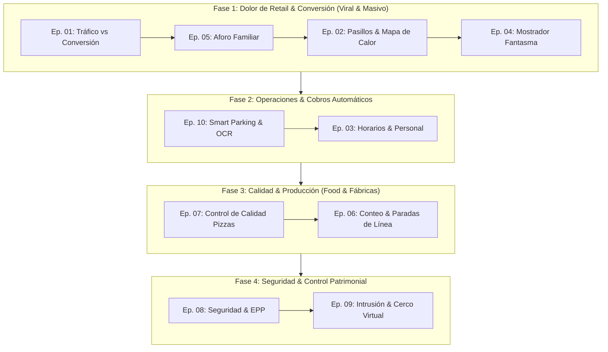

# 📅 Calendario & Estrategia Maestra de Publicación en TikTok • VigIA Suite (10 Episodios)

Este documento establece el **orden cronológico óptimo**, los **textos de portada (thumbnails de alto CTR)** y los **títulos de texto para los primeros segundos (In-Video Hooks para SEO de TikTok)** para los 10 videos interactivos desarrollados.

> [!IMPORTANT]
> **Estrategia SEO Nativo de TikTok:**  
> Ninguno de los videos lleva el texto inicial incrustado permanentemente en los primeros 3 segundos. **Agrégalo directamente desde la herramienta de texto de la app de TikTok** antes de publicar. Esto permite que el algoritmo de TikTok transcriba, indexe y recomiende el video a personas buscando palabras clave como _"cómo vender más en retail"_, _"control de parqueos"_, _"seguridad industrial"_, etc.

---

## 🗺️ Mapa General del Embudo (Funnel de 4 Fases)

---

## 🎬 Detalle de Publicación: Video por Video

### 1️⃣ Episodio 01: "La Ilusión del Local Lleno" (Tráfico vs Conversión)

- **Archivos:** [`tiktok_personas.html`](file:///home/fabian/Documents/Projects/StartUps/VigIA/VigIA/tiktok_personas.html) • [`tiktok_personas_guion.md`](file:///home/fabian/Documents/Projects/StartUps/VigIA/VigIA/tiktok_personas_guion.md)
- **Objetivo:** Abrir la cuenta con el dolor más universal del comercio físico: creer que tener gente adentro equivale a dinero en caja.
- **🖼️ Texto en Portada de TikTok (Thumbnail):**
  > **"1,820 CLIENTES Y CAÍSTE AL 11% 📉"**
- **⚡ Texto para los Primeros Segundos (0–3.5s en Editor TikTok):**
  > _"¿Tu tienda está vendiendo más o solo se está llenando?"_
- **💡 Por qué funciona:** Genera disonancia cognitiva inmediata en cualquier dueño de tienda que presume ver su local abarrotado.

---

### 2️⃣ Episodio 05: "El Engaño del Aforo Familiar" (Grupos de Compra)

- **Archivos:** [`tiktok_grupos.html`](file:///home/fabian/Documents/Projects/StartUps/VigIA/VigIA/tiktok_grupos.html) • [`tiktok_grupos_guion.md`](file:///home/fabian/Documents/Projects/StartUps/VigIA/VigIA/tiktok_grupos_guion.md)
- **Objetivo:** Destruir los contadores de personas tradicionales de puerta (los sensores infrarrojos o cámaras chinas de baja gama).
- **🖼️ Texto en Portada de TikTok (Thumbnail):**
  > **"¿POR QUÉ TU CONVERSIÓN MIENTE? 🤯📊"**
- **⚡ Texto para los Primeros Segundos (0–3.5s en Editor TikTok):**
  > _"El error de contar cabezas en vez de familias que pagan un solo ticket."_
- **💡 Por qué funciona:** Le enseña al dueño de negocio un concepto nuevo (_Unidad de Compra Real_), posicionando a VigIA como autoridad analítica.

---

### 3️⃣ Episodio 02: "El Misterio de la Zona Muerta" (Heatmaps & Pasillos)

- **Archivos:** [`tiktok_heatmap.html`](file:///home/fabian/Documents/Projects/StartUps/VigIA/VigIA/tiktok_heatmap.html) • [`tiktok_heatmap_guion.md`](file:///home/fabian/Documents/Projects/StartUps/VigIA/VigIA/tiktok_heatmap_guion.md)
- **Objetivo:** Visualizar el espacio físico. Todo dueño de tienda tiene un pasillo o rincón donde los productos no rotan.
- **🖼️ Texto en Portada de TikTok (Thumbnail):**
  > **"EL PASILLO DONDE PIERDES $4,500 🔥"**
- **⚡ Texto para los Primeros Segundos (0–3.5s en Editor TikTok):**
  > _"¿Por qué el 70% de tus clientes nunca doblan hacia la derecha?"_
- **💡 Por qué funciona:** La curiosidad espacial engancha al espectador para ver el mapa de calor y comparar con su propia tienda.

---

### 4️⃣ Episodio 04: "El Mostrador Fantasma" (Tiempos de Espera & Fuga)

- **Archivos:** [`tiktok_mostrador.html`](file:///home/fabian/Documents/Projects/StartUps/VigIA/VigIA/tiktok_mostrador.html) • [`tiktok_mostrador_guion.md`](file:///home/fabian/Documents/Projects/StartUps/VigIA/VigIA/tiktok_mostrador_guion.md)
- **Objetivo:** Fuga de ventas en el punto crítico de atención (mostrador desatendido mientras el cliente espera >4 min).
- **🖼️ Texto en Portada de TikTok (Thumbnail):**
  > **"CLIENTES ESPERANDO SOLOS EN CAJA ⏱️🚨"**
- **⚡ Texto para los Primeros Segundos (0–3.5s en Editor TikTok):**
  > _"4 minutos esperando frente al mostrador y el cliente se marchó."_
- **💡 Por qué funciona:** Es una escena que todo el mundo ha vivido como cliente y que todo dueño teme que pase en su negocio.

---

### 5️⃣ Episodio 10: "Smart Parking & Control de Placas OCR" (Cobro Automático)

- **Archivos:** [`tiktok_parqueos.html`](file:///home/fabian/Documents/Projects/StartUps/VigIA/VigIA/tiktok_parqueos.html) • [`tiktok_parqueos_guion.md`](file:///home/fabian/Documents/Projects/StartUps/VigIA/VigIA/tiktok_parqueos_guion.md)
- **Objetivo:** Abrir el vertical de movilidad y control de accesos vehiculares (edificios, centros comerciales, garajes).
- **🖼️ Texto en Portada de TikTok (Thumbnail):**
  > **"¿CUÁNTO PIERDE TU PARQUEO EN CAJA? 🚗📉"**
- **⚡ Texto para los Primeros Segundos (0–3.5s en Editor TikTok):**
  > _"Los boletos de papel ya murieron. Así cobra un parqueo con Inteligencia Artificial."_
- **💡 Por qué funciona:** Toca directo el bolsillo del dueño: desvío de dinero en efectivo y boletos manipulados.

---

### 6️⃣ Episodio 03: "El Desfase de Horarios & Personal" (Matriz de Tráfico)

- **Archivos:** [`tiktok_horarios.html`](file:///home/fabian/Documents/Projects/StartUps/VigIA/VigIA/tiktok_horarios.html) • [`tiktok_horarios_guion.md`](file:///home/fabian/Documents/Projects/StartUps/VigIA/VigIA/tiktok_horarios_guion.md)
- **Objetivo:** Optimización de costos laborales: nómina sobredimensionada en horas muertas vs falta de personal en horas pico.
- **🖼️ Texto en Portada de TikTok (Thumbnail):**
  > **"PAGANDO SUELDOS EN HORAS MUERTAS 💸"**
- **⚡ Texto para los Primeros Segundos (0–3.5s en Editor TikTok):**
  > _"Tienes 4 cajeros cuando no hay nadie y solo 1 en tu hora pico."_
- **💡 Por qué funciona:** Los costos de personal son el segundo gasto operativo más grande en retail después del alquiler.

---

### 7️⃣ Episodio 07: "Calidad en Alimentos & Cocinas Industriales" (Control Óptico en Línea)

- **Archivos:** [`tiktok_pizzas.html`](file:///home/fabian/Documents/Projects/StartUps/VigIA/VigIA/tiktok_pizzas.html) • [`tiktok_pizzas_guion.md`](file:///home/fabian/Documents/Projects/StartUps/VigIA/VigIA/tiktok_pizzas_guion.md)
- **Objetivo:** Penetrar en dark kitchens, cadenas de pizzerías, panaderías industriales, empaque y franquicias gastronómicas.
- **🖼️ Texto en Portada de TikTok (Thumbnail):**
  > **"¿EL 14% DE TU PRODUCCIÓN TIENE DEFECTOS? 🍕🔥"**
- **⚡ Texto para los Primeros Segundos (0–3.5s en Editor TikTok):**
  > _"Bordes quemados, tamaño irregular o toppings corridos. ¿Cuánta merma pierdes por turno?"_
- **💡 Por qué funciona:** Lo gastronómico e industrial es sumamente visual y genera alto tiempo de reproducción (_watch time_).

---

### 8️⃣ Episodio 06: "Manufactura & Control de Línea" (Conteo & Paradas Silenciosas)

- **Archivos:** [`tiktok_produccion.html`](file:///home/fabian/Documents/Projects/StartUps/VigIA/VigIA/tiktok_produccion.html) • [`tiktok_produccion_guion.md`](file:///home/fabian/Documents/Projects/StartUps/VigIA/VigIA/tiktok_produccion_guion.md)
- **Objetivo:** Plantas industriales, embotelladoras, fábricas de manufactura, OEE y auditoría de paradas de cinta no registradas.
- **🖼️ Texto en Portada de TikTok (Thumbnail):**
  > **"¿PRODUCES 10,000 O SOLO LO CREES? 🏭⚠️"**
- **⚡ Texto para los Primeros Segundos (0–3.5s en Editor TikTok):**
  > _"Crees que produces 10,000 unidades por turno y la cinta se detiene sin que te enteres."_
- **💡 Por qué funciona:** Plantea una pregunta numérica contundente de pérdida oculta en cualquier tipo de fábrica o taller.

---

### 9️⃣ Episodio 08: "Seguridad Industrial & Detección de EPP" (Cascos y Chalecos)

- **Archivos:** [`tiktok_epp.html`](file:///home/fabian/Documents/Projects/StartUps/VigIA/VigIA/tiktok_epp.html) • [`tiktok_epp_guion.md`](file:///home/fabian/Documents/Projects/StartUps/VigIA/VigIA/tiktok_epp_guion.md)
- **Objetivo:** Constructoras, minería, logística, almacenes y cumplimiento de normativas de trabajo (HSE).
- **🖼️ Texto en Portada de TikTok (Thumbnail):**
  > **"¿UNA MULTA POR NO USAR CASCO? 🦺🚨"**
- **⚡ Texto para los Primeros Segundos (0–3.5s en Editor TikTok):**
  > _"El 68% de accidentes en obra ocurren cuando nadie está mirando."_
- **💡 Por qué funciona:** Miedo a las multas de inspección laboral y paros de obra.

---

### 🔟 Episodio 09: "Seguridad Patrimonial & Cerco Virtual" (Intrusión Nocturna)

- **Archivos:** [`tiktok_intrusion.html`](file:///home/fabian/Documents/Projects/StartUps/VigIA/VigIA/tiktok_intrusion.html) • [`tiktok_intrusion_guion.md`](file:///home/fabian/Documents/Projects/StartUps/VigIA/VigIA/tiktok_intrusion_guion.md)
- **Objetivo:** Cerrar el ciclo con seguridad patrimonial activa: convertir cámaras pasivas en alarmas disuasorias.
- **🖼️ Texto en Portada de TikTok (Thumbnail):**
  > **"¿TUS CÁMARAS SOLO MIRAN O DEFIENDEN? 🚨👁️"**
- **⚡ Texto para los Primeros Segundos (0–3.5s en Editor TikTok):**
  > _"¿De qué sirve tener 20 cámaras si solo ves el robo al día siguiente?"_
- **💡 Por qué funciona:** Es la queja universal contra los sistemas de seguridad tradicionales: solo sirven para el forense después del robo.

---

## 📊 Tabla Resumen de Publicación Rápida

| Turno  | Episodio                 | Tema Clave               | Texto en Portada (Thumbnail)                    | Texto Inicial 0-3s (Editor TikTok)                      |
| :----: | :----------------------- | :----------------------- | :---------------------------------------------- | :------------------------------------------------------ |
| **01** | `tiktok_personas.html`   | Conversión vs Tráfico    | **"1,820 CLIENTES Y CAÍSTE AL 11% 📉"**         | _"¿Tu tienda vende más o solo se está llenando?"_       |
| **02** | `tiktok_grupos.html`     | Familias vs Compradores  | **"¿POR QUÉ TU CONVERSIÓN MIENTE? 🤯📊"**       | _"El error de contar cabezas en vez de familias."_      |
| **03** | `tiktok_heatmap.html`    | Pasillos y Zonas Muertas | **"EL PASILLO DONDE PIERDES $4,500 🔥"**        | _"¿Por qué el 70% nunca dobla a la derecha?"_           |
| **04** | `tiktok_mostrador.html`  | Atención & Espera        | **"CLIENTES ESPERANDO SOLOS EN CAJA ⏱️🚨"**     | _"4 minutos esperando y el cliente se marchó."_         |
| **05** | `tiktok_parqueos.html`   | Smart Parking OCR        | **"¿CUÁNTO PIERDE TU PARQUEO EN CAJA? 🚗📉"**   | _"Los boletos de papel murieron. Así cobra la IA."_     |
| **06** | `tiktok_horarios.html`   | Matriz de Turnos         | **"PAGANDO SUELDOS EN HORAS MUERTAS 💸"**       | _"Tienes 4 cajeros sin gente y solo 1 en hora pico."_   |
| **07** | `tiktok_pizzas.html`     | Calidad Pizzas           | **"¿CUÁNTAS PIZZAS SALEN QUEMADAS? 🍕🔥"**      | _"A 300 grados no pueden medir milímetros."_            |
| **08** | `tiktok_produccion.html` | Conteo de Botellas       | **"¿PRODUCES 10,000 O SOLO LO CREES? 🏭⚠️"**    | _"Crees que produces 10,000 y empacas 8,200."_          |
| **09** | `tiktok_epp.html`        | Seguridad & EPP          | **"¿UNA MULTA POR NO USAR CASCO? 🦺🚨"**        | _"El 68% de accidentes ocurren sin supervisión."_       |
| **10** | `tiktok_intrusion.html`  | Cerco Virtual            | **"¿TUS CÁMARAS SOLO MIRAN O DEFIENDEN? 🚨👁️"** | _"¿De qué sirve si solo ves el robo al día siguiente?"_ |

---

## ⏰ Pautas de Publicación para Máximo Rendimiento

1. **Frecuencia sugerida:** 1 video cada 2 días (ej. Lunes, Miércoles, Viernes).
2. **Horarios de mayor tracción B2B:**
   - **Mediodía:** `12:00 – 13:30 hrs` (almuerzo de gerentes y comerciantes).
   - **Noche:** `19:00 – 20:30 hrs` (cierre de caja y balance del día).
3. **Música en TikTok:** Busca audios en tendencia en la categoría _"Tech / Minimal Trap / Suspense"_ y baja el volumen del audio comercial al 10-15%, manteniendo el audio de tu locución al 100%.
